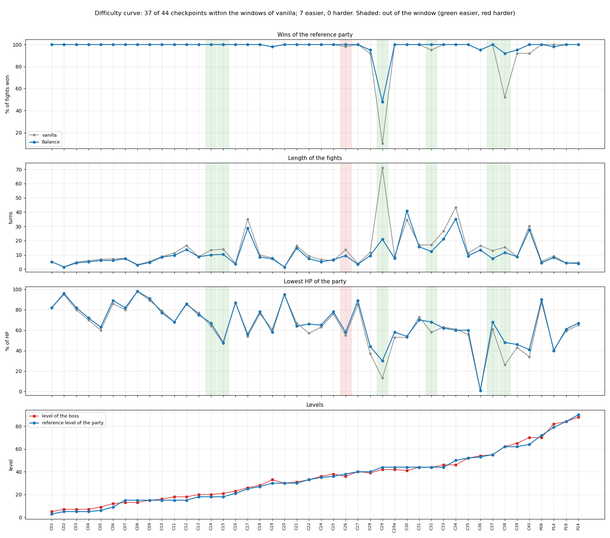
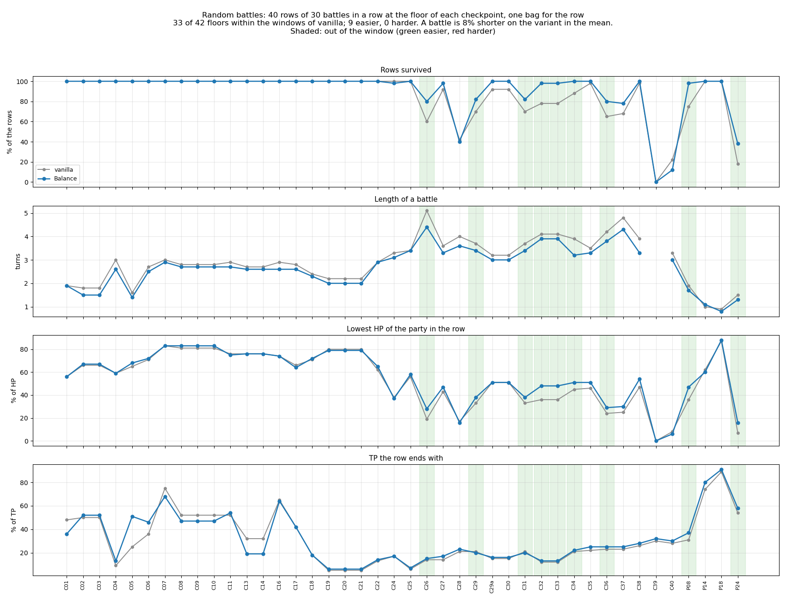
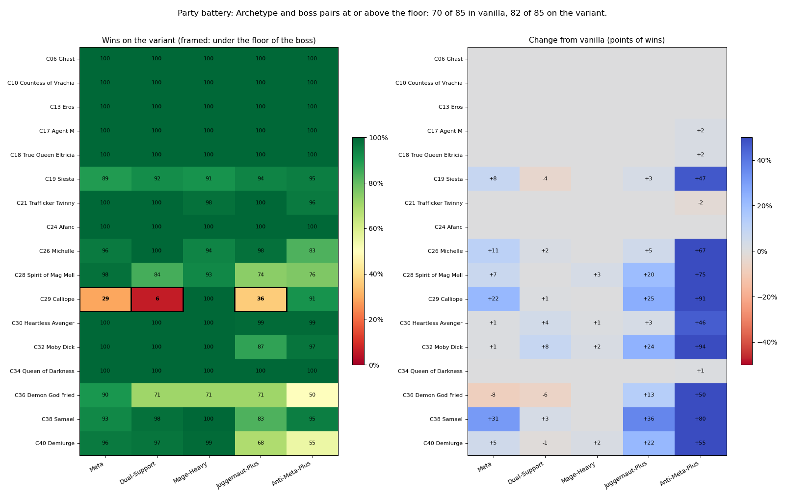
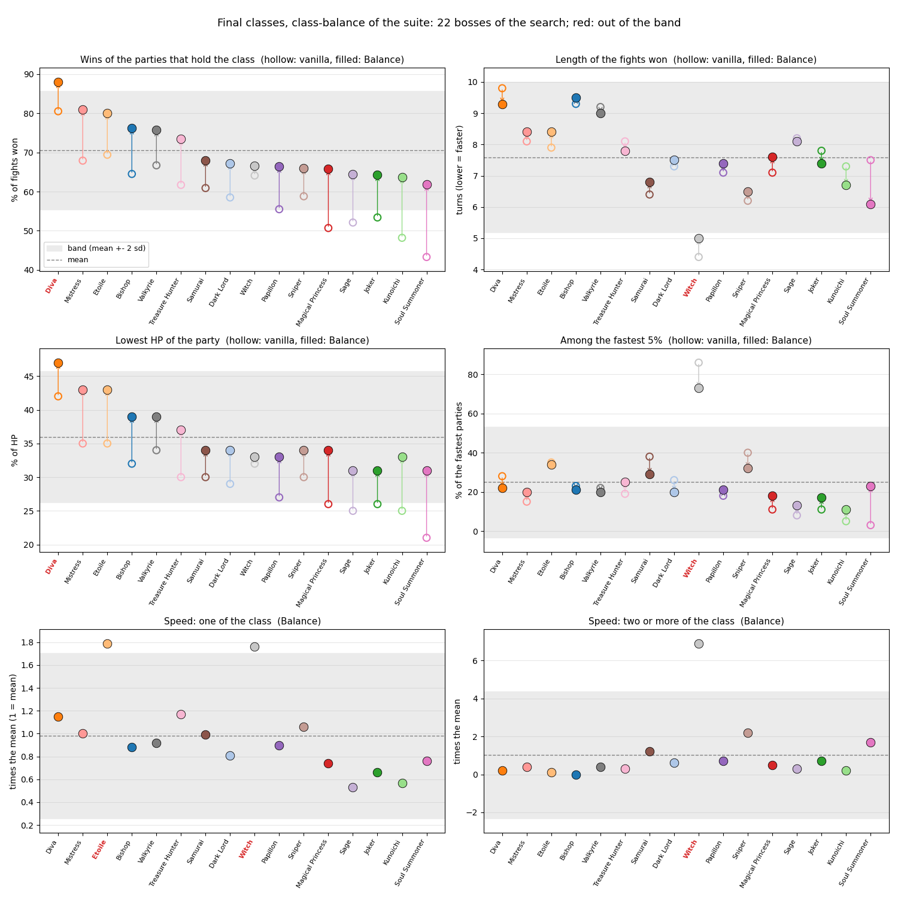
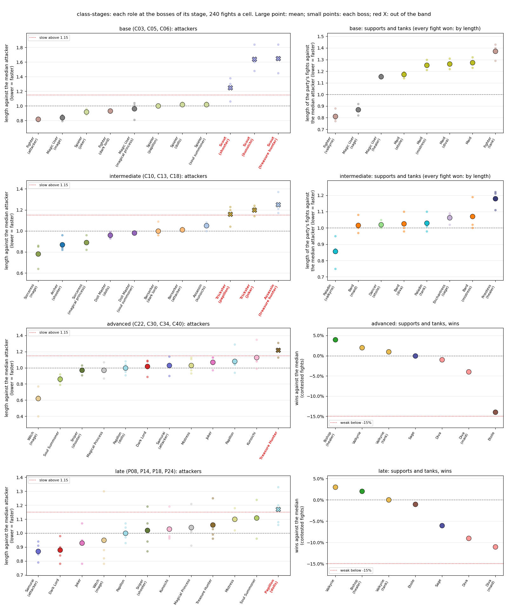
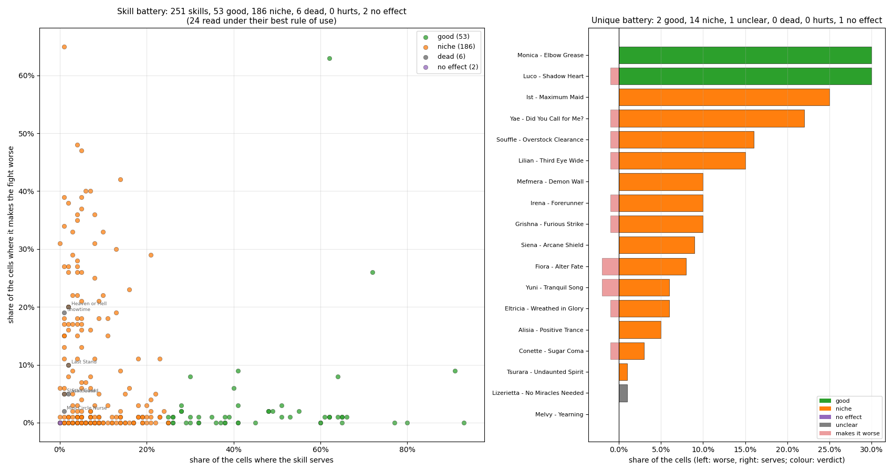
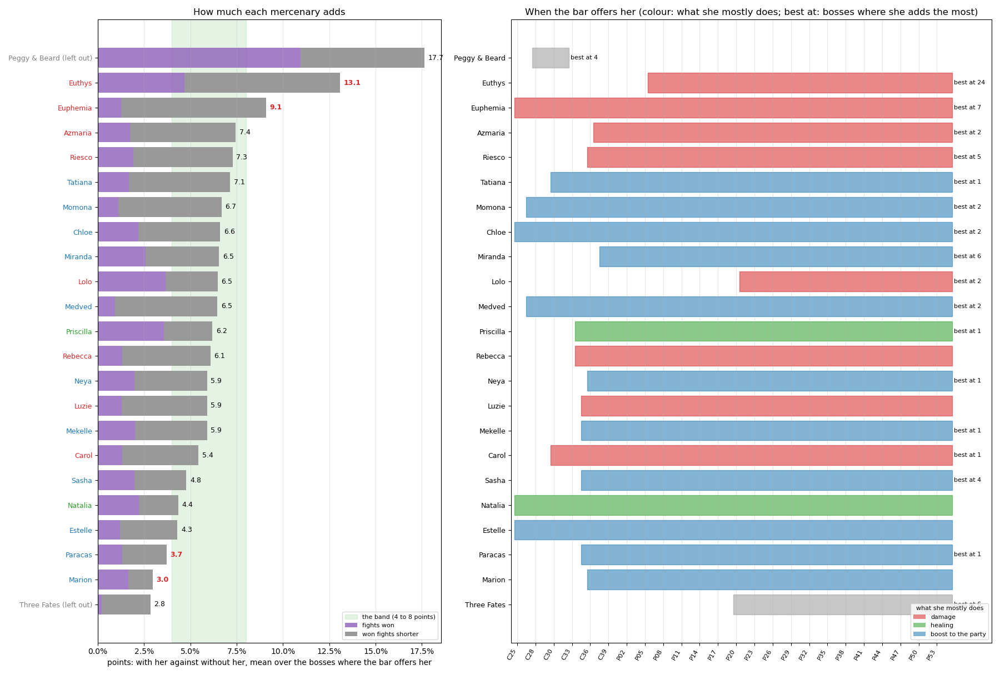

# Dungeon Travelers 2-2: QoL & Balance Mod

A modification suite for *Dungeon Travelers 2-2: The Fallen Maidens & the Book of Beginnings* (PC, English release).

In the original game, most combat mechanics are hidden behind vague tooltips. Skills state "Damage UP", healing items restore "a little", and turn delays or status chances are never explained. This project makes those hidden numbers visible and, in the Balance variant, reworks underperforming classes and skills to make all playstyles viable.

All formulas were decompiled directly from the game's executable, and balance adjustments were benchmarked using a combat engine matching those exact formulas.

The mod is available in two separate versions.

---

## 1. QoL Variant

A pure visual and informational upgrade that leaves original gameplay values untouched. Damage formulas, drop rates, skill costs, and enemy stats remain 100% identical to the base game.

* **Skills**: Descriptions show real numbers across all levels (damage multipliers, accuracy bonuses, status ailment chances, durations, TP costs, and action speed).
* **Equipment & Enchants**: Tooltips show exact stat modifiers instead of generic "UP" tags (e.g., `DEX +10%`, `Fire Res +20`, `Recover 2 TP per turn`).
* **Weapons**: Titles display accurate attack speed ranks and recovery delay multipliers (e.g., `Speed E+ (2.45x)`).
* **Items & Food**: Healing items display flat and percentage restoration values; meals show exact buff effects and step durations.
* **Summons & Mercenaries**: Complete data lines displaying action targets, damage types, and skill chances.
* **Text fixes**: Corrects typos and mislabeled numbers present in the official English script while leaving jokes and character dialogue intact.

### Before & After: Skill Descriptions

In the unmodded game, skill descriptions hide combat numbers behind vague labels like "Damage UP" or "Freeze rate UP". The QoL mod reveals exact scaling, ailment rates, and resource costs for every level:

**Vanilla (Original Game):**
```text
Frost Slash
Short-range skill. Deal mid-range water damage to one enemy. May freeze.
LvUp: Damage UP Freeze rate UP
Time until next turn DOWN TP Cost UP
```

**QoL Mod:**
```text
Frost Slash
Short-range skill. Severe mid-range water damage. May freeze (20-50%).
ATK: 130% -> 144 -> 157 -> 170 -> 182 -> 194 -> 204 -> 212 -> 220 -> 228% (L10)
Freeze: 20% (+3-4%/Lv) -> 50% | Accuracy: +14% | TP Cost: 9 (+3/Lv) -> 36
```

At a glance, the player sees the full damage progression (130% to 228%), exact freeze chance (20% scaling to 50%), hidden accuracy bonus (+14%), and TP costs per level, eliminating all guesswork during dungeon crawling.

Every displayed value is verified directly against the game data during the build process.

---

## 2. Balance Variant

Includes everything from the QoL variant, plus targeted gameplay rebalancing across classes, skills, equipment, and encounters. Changes are grounded in feedback from the Japanese community wiki and English walkthrough guides.

* **Class Viability**: Underperforming classes (Doll Master line, Kunoichi, Mistress, Magical Princess, Trickster) receive improved damage scaling and reasonable TP economy.
* **Expanded Options**: Neglected skills, underpowered weapon families (daggers, whips, guns), and status ailments are effective options throughout the game.
* **Catch-up Progression**: Characters below the enemy level threshold gain increased experience, allowing benched or late-joining allies to catch up in a few encounters. Crown requirements are also reduced.
* **Bug Fixes**: Restores non-functional passives (such as Concentrate, which had no effect in the vanilla code).
* **Fair Encounters**: Boss encounters maintain their intended challenge and tension without forcing players into a narrow meta composition.

The full changelog is available in [installer/README_Balance.txt](installer/README_Balance.txt).

---

## Installation

Requirements: Windows PC and an unmodified copy of *Dungeon Travelers 2-2* (English PC version).

1. Download the archive for your preferred variant from [Releases](../../releases).
2. Exit the game if it is running.
3. Extract the contents directly into your game folder (alongside the `.exe` and the `Data/` directory).
4. Run `Install_Balance.bat` or `Install_QoL.bat`.

The installer automatically verifies files before applying changes and stores untouched originals in `DT22_Mod\backup`. To restore the unmodded game, run `Uninstall_DT22_Mod.bat`. You can switch between variants at any time by installing the other archive over the existing one.

Save files are fully compatible and are not altered by either mod variant.

---

## Building from Source

Building locally requires Python 3.10+ and the .NET 10 SDK (for the C# simulation engine).

```bash
pip install -r requirements.txt
```

Place your game directory in the repository root as `DungeonTravelers2-2_EN`, or configure its location in `config.json`:

```json
{ "game_dir": "D:/Games/DungeonTravelers2-2_EN" }
```

Build and apply a variant directly:

```bash
python tools/apply_mod.py balance
```

Useful development commands:

| Command | Description |
|---|---|
| `python tools/package_all.py` | Builds and packages both release zips into `dist/` |
| `python -m unittest discover -s tests -p "test_*.py"` | Runs the Python test suite |
| `python tools/full_suite.py` | Runs all balance benchmarks, audits, and chart generation |
| `python tools/exe_patch.py status` | Checks the status of binary executable patches |

---

## Architecture & Data Integrity

All gameplay values, rules, and text strings reside in spreadsheets under `data_tables/`, keeping balance data decoupled from script logic:

* `balance_changes.xlsx`: Contains every modified value with its original figure and rationale.
* `FORMULAS.md`: Complete reverse-engineered combat formulas with binary function offsets.
* `engine_cs/`: C# combat engine used to benchmark encounter outcomes across hundreds of simulated party variations.

The build pipeline enforces strict data consistency: if a tooltip number disagrees with the underlying binary data, the build immediately aborts.

For detailed developer documentation, see [docs/README.md](docs/README.md) and [CONTRIBUTING.md](CONTRIBUTING.md).

---

## Performance & Balance Benchmarks

The automated test suite (`python tools/full_suite.py`) regenerates these charts from battle simulations across all main story checkpoints. Grey represents vanilla performance; blue represents the Balance variant.

### Story Difficulty Curve



Evaluates the benchmark party at each checkpoint at the expected progression level. The panels display win rate, combat duration in turns, and minimum remaining party HP. The bottom panel compares boss levels against party levels.

### Dungeon Exploration & Resource Drain



Simulates continuous dungeon exploration without restocking consumable items between encounters. Traces party survival rates, fight durations, lowest health, and remaining TP across consecutive battles.

### Party Archetype Battery



Tests five distinct party compositions (from optimized meta to off-meta setups) against story bosses. Shows overall win rates and performance deltas relative to the unmodded game.

### Final Class Distribution



Evaluates all final advanced classes against story bosses. Each point represents a class (open circle = vanilla, solid circle = Balance). The shaded band represents the target performance distribution ($\pm 2\sigma$).

### Class Performance by Stage



Tracks class balance across progression tiers (basic, intermediate, advanced, and postgame). Compares damage output relative to the median damage dealer and support/tank survivability.

### Skill Utility



Measures the impact of class and unique skills across multiple party compositions. Maps scenarios where a skill provides a tangible tactical benefit versus scenarios where it underperforms.

### Mercenaries



Evaluates mercenary companions hired alongside Grand Sealbook summons at their respective progression stages. Compares win rate contributions across multiple encounter sets.

---

## License & Credits

* Code and documentation in this repository are licensed under the [MIT License](LICENSE).
* *Dungeon Travelers 2-2* is developed by Aquaplus and Sting.
* Numerical cross-referencing and community insights sourced from the Japanese atwiki community and GameFAQs guides by Hentaicheg and DoopDoop. See [docs/CREDITS.md](docs/CREDITS.md).
