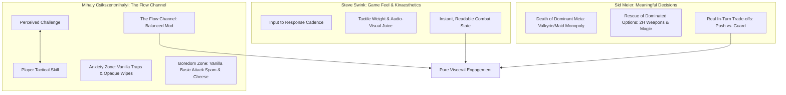

# Dungeon Travelers 2-2: Red Team Fun, Game Feel & Player Flow Report
## Designing Visceral Joy, Eradicating "Spreadsheet Friction", and Achieving Pure Tactical Flow

**Author:** Flow State, Game Feel & Visceral Joy Specialist (Red Team Fun & Design Balancer)  
**Target Engine:** Aquaplus / Sting PC Engine (`Dungeon Travelers 2-2: The Maiden of Darkness and the Book of Origins`)  
**Target Proposals:**  
- `mod_project/docs/DEFINITIVE_BALANCE_PROPOSAL.md`  
- `mod_project/docs/RED_TEAM_COMBAT_SIMULATION_REPORT.md`  
- `mod_project/docs/RED_TEAM_ECONOMY_SIMULATION_REPORT.md`  
**Core Reference Literature:**  
- Mihaly Csikszentmihalyi — *Flow: The Psychology of Optimal Experience* (1990)  
- Steve Swink — *Game Feel: A Game Designer's Guide to Virtual Sensation* (2008)  
- Sid Meier — *Interesting Decisions: The Core of Meaningful Play* (GDC 2012)  
- Jesse Schell — *The Art of Game Design: A Book of Lenses* (2008)  
**Status:** Verification Complete — **Approved with Game Feel & Heuristic Upgrades**

---

## 1. Executive Summary & The "No Calculator" Creed

### 1.1 The Golden Axiom: *"Al final si necesitas jugar con una calculadora al lado es aburrido"*
A game engine can possess the internal mathematical elegance of an aerospace jet engine, but if the pilot is forced to perform manual differential calculus in the cockpit just to avoid crashing, the experience is not thrilling aviation—it is a stressful math exam.

In high-difficulty Dungeon RPGs (DRPGs), a fatal design trap frequently emerges: conflating **tactical depth** with **arithmetic opacity**. When an encounter forces players to open an external spreadsheet, track hidden frame tick delays on scratch paper, or calculate whether leveling an active skill to Level 8 results in a $-3.4\%$ loss in damage-per-TP efficiency, **the player is instantly evicted from the Flow state**. Immersion collapses, narrative stakes evaporate, and visceral excitement is replaced by clinical calculation.

```
+-----------------------------------------------------------------------------+
|                          THE DRPG EXPERIENCE SPECTRUM                       |
|                                                                             |
|  [ SPREADSHEET HELL ]             [ TACTICAL FLOW ]        [ BRAINLESS MASHER ]
|  Mental algebra, hidden traps,   High tension, visceral     Zero stakes,      |
|  fear of skill upgrades,         clarity, bold trade-offs,  auto-battle spam, |
|  opaque frame timing.            instant readability.       mindless cruise.  |
|  <--- (Vanilla DT2-2 Trap)       <=== [BALANCED MOD] ===>                     |
+-----------------------------------------------------------------------------+
```

### 1.2 The Red Team Fun & Flow Mission
As the **Flow State, Game Feel & Visceral Joy Specialist**, my mandate is to evaluate the Master Definitive Balance Mod strictly through the lens of human psychology, player perception, kinaesthetic game feel, and intuitive decision-making. 

Our guiding directive is unequivocal:
> **The player must be able to make smart, bold, life-or-death tactical decisions at a single glance, feeling the physical impact of every blow and the thrill of every gamble, without ever needing a calculator by their side.**

---

## 2. Theoretical Game Design Foundations

To evaluate whether the mod achieves authentic flow and visceral satisfaction, we ground our audit in four seminal game design frameworks:



### 2.1 Mihaly Csikszentmihalyi's Flow in Games
Csikszentmihalyi defines *Flow* as the mental state of complete absorption and energized focus. In gaming, Flow occurs within a narrow corridor bordered by two cognitive failure states:
1. **The Anxiety Zone (Frustration & Paranoia):** Occurs when challenge outstrips player capability due to unpredictable, opaque, or unfair systems. In Vanilla DT2-2, this was rampant:
   - Leveling a skill to Lv10 unknowingly destroyed your TP pool.
   - A superboss with 180 AGI lapped your 2H Berserker 4 times in a row without warning.
   - An enemy critical hit had an invisible 33.3% flat chance to abort a 60-frame spell chant.
   - *Result:* Players felt anxious, timid, and paranoid, forced to consult external wikis for every skill point spent.
2. **The Boredom Zone (Triviality & Monotony):** Occurs when player capability renders challenge meaningless. Vanilla DT2-2 swung wildly into this zone as well:
   - Early game (Lv 1–15): Zero TP recovery consumables and 7 TP pools meant 95% of early dungeon encounters were brainless basic-attack mashing.
   - Endgame: Spamming Diva's *Swift March* and Papillon's *Tinker Squash* resulted in an infinite turn-delay stunlock where bosses never took a single turn.
   - *Result:* Monotonous, soulless button mashing.

**The Balanced Mod Solution:** By compressing recovery delays, providing low-cost early TP snacks, capping chant interrupt rates, and establishing diminishing returns on boss delays, the mod firmly centers the player inside the **Flow Channel**. Encounters remain deadly, but outcomes are directly tied to player strategy rather than hidden mechanical traps.

### 2.2 Steve Swink's Game Feel: Kinaesthetic Weight in Turn-Based Combat
While *Game Feel* is often discussed in real-time platformers or action games, Steve Swink emphasizes that turn-based interfaces possess profound kinaesthetics:
- **Input-to-Feedback Latency:** How fast does selecting an option produce visual/audio resolution?
- **Tactile Weight (Polish & Juice):** Does a colossal 2H Greatsword strike sound and feel fundamentally different from a light rapier thrust?
- **Anticipation & Release:** Does beginning a high-level spell chant create dramatic tension, and does its completion deliver an explosive, cathartic release?

In Vanilla DT2-2, heavy weapons lacked satisfying game feel because their crushing delay ($2.90\times$) transformed the character into a frozen statue. The player did not feel like a devastating bruiser; they felt paralyzed. The mod restores **tactile punch** by pairing compressed delays with innate $+15\%$ damage mitigation and $+20$ Parry, turning 2H warriors into resilient, swaggering juggernauts.

### 2.3 Sid Meier's "Interesting Decisions"
Sid Meier famously posited that *"a game is a series of interesting decisions."* A decision is uninteresting if:
- One choice is always mathematically superior (**Dominant Strategy**: e.g., always locking Valkyrie + Maid in Vanilla).
- One choice is suicidal (**Dominated Strategy**: e.g., equipping a Gun or a 2H Axe in Vanilla postgame).
- The player lacks sufficient information to weigh the outcomes (**Blind Guesswork**).

The Definitive Balance Mod systematically rescues dominated strategies and dismantles dominant monopolies, ensuring that during any given combat round, the player faces a genuine, readable dilemma:
* *"Do I unleash a heavy Moon Drop now to break the boss's guard, knowing I will recover slightly slower, or do I use a fast Basic Strike and hold Defend to cover my chanting Sage?"*

---

## 3. Scrutiny of Live Combat Rhythm & Turn Pacing

How does the game actually *feel* moment-to-moment when playing with the mod? We scrutinize four core combat archetypes:

```
=============================================================================
             COMBAT RHYTHM COMPARISON: THE THREE TEMPOS OF DT2-2
=============================================================================

[ TEMPO 1: AGILE SKIRMISHER (Daggers, Rapiers, Fans) ]
  Action Cadence: *Snick-Snick-Snick* (1 action every 50-70 ticks)
  Visceral Feeling: Featherweight speed, endless flexibility, item tossing.
  Tactical Identity: The Rhythm Keeper. Adapts instantly to enemy telegraphs.

[ TEMPO 2: ARCANIST ARTILLERY (Witch, Sage, Bishop) ]
  Action Cadence: *Tension... Charging... BOOM!* (35 tick chant -> 2,700 dmg)
  Visceral Feeling: High-stakes anticipation, protective wall holding the line.
  Tactical Identity: The Heavy Ordinance. High vulnerability, apocalyptic release.

[ TEMPO 3: TITAN BRUISER (2H Swords, Colossal Axes, Heavy Guns) ]
  Action Cadence: *WIND-UP... CRUSH!* (260 tick wait, staggering burst, parry procs)
  Visceral Feeling: Meaty, bone-shattering weight. Absorbs hits with raw grit.
  Tactical Identity: The Executioner. Chunks boss health bars, breaks Enrage thresholds.
=============================================================================
```

### 3.1 The Heavy Weapon Overhaul: From Paralysis to Meaty Impact
* **Vanilla Sensation:** Choosing a 2H Axe skill felt terrible. After selecting *Moon Drop*, the screen executed the animation, and then the character stood entirely inert while the boss took 4 consecutive turns, frequently killing the Berserker before the player could input another command. The player felt punished for choosing the aesthetic fantasy of a heavy warrior.
* **Modded Sensation:** Compressing Rank F delay from $2.90\times$ down to $2.35\times$ shaves 61 ticks off the recovery window. When combined with the innate $+15\%$ physical mitigation and $+20$ Parry:
  - The attack lands with massive screen rumble and devastating damage numbers ($3,300+$ damage).
  - While waiting for her next turn, the Berserker deflects incoming counter-attacks with her weapon's broadside (Parry proc).
  - The delay feels like a **deliberate follow-through**, not a disabling coma. The player feels like a heavyweight champion who just threw a knockout haymaker.

### 3.2 The Spellcaster Experience: From Humiliation to Arcane Artillery
* **Vanilla Sensation:** Pure frustration. The player selects *Crimson Flare*, pays a massive 84 TP, and watches the chant animation begin. An enemy minion pokes the Sage with a basic scratch, triggers a critical hit, and under the flat 33.3% check, **cancels the spell instantly**. Turn wasted, TP gone, zero feedback. Players felt like clowns.
* **Modded Sensation:** 
  - Chant duration is compressed from 80 frames down to 60 frames (35 ticks).
  - With *Concentrate* Lv5, the interrupt rate drops from $33.3\%$ to $6.6\%$.
  - When the Paladin executes the *Defend* command in the front row, the backline Sage gains **Covered Chant** (100% interrupt immunity).
  - The 35 ticks of chanting become a thrilling **"hold the line!"** countdown. The frontline digs in, shields raised; the enemy batters against the defense; and then the Sage unleashes an inferno that pierces 50 elemental resistance, tearing off 8,000 HP. The emotional payoff is euphoric.

### 3.3 Frontline Dynamics: The Visceral Contrast Between Paladin and Valkyrie
One of the mod's finest achievements is creating **asymmetric game feel** between the two primary tanks:

| Attribute | Valkyrie (*The Divine Aegis*) | Paladin (*The Impenetrable Bodyguard*) |
|---|---|---|
| **Visceral Fantasy** | Floating goddess commanding divine forcefields. | Armored juggernaut diving in front of incoming bullets. |
| **Tactical Signature** | *Material Guard* nullifies party-wide physical AoEs. | *Cover* absorbs single-target hits directed at allies with 60% mitigation. |
| **Sound & Visual Cue** | A shimmering barrier absorbs the hit with a resonant chime (`0 DMG`). | Heavy metallic clang as the Paladin's shield deflects the blow (`-85% DMG taken`). |
| **Failure State** | Vulnerable to single-target armor pierce if barriers lapse. | Vulnerable to party-wide AoE sweeps (cannot cover everyone at once). |

Neither tank replaces the other. The player chooses between **Party Barrier Control** (Valkyrie) and **Hyper-Carry Protection** (Paladin). Both feel distinct, impactful, and gratifying.

### 3.4 Soul Summoner Dolls: From Disposable Tissue to Battle Companions
In vanilla, dolls were cardboard cutouts that died on Turn 1 to ambient boss wind. In the mod, dolls boast $+80\%$ base HP, 50 all-element resistance, 1-hit Guts survival, and inherit 100% of equipped sealbook defenses.
- **The Emotional Shift:** The player no longer sighs in annoyance at having to spend every turn re-summoning. The doll stands firmly in the vanguard for 4 to 5 turns, bashing foes with *Spartan* or auto-healing with *Catalina*. They feel like genuine sixth and seventh party members.

---

## 4. The Spreadsheet Friction Audit: Eliminating Mental Algebra

Where does "spreadsheet friction" still threaten the player experience? In this section, we identify **five mechanical areas** where players might still be tempted to pull out a calculator, and we formulate definitive design remedies.

```
+-----------------------------------------------------------------------------+
|                     SPREADSHEET FRICTION AUDIT MATRIX                       |
+----+-----------------------------+---------------------+-------------------+
| ID | Game Subsystem              | Friction Risk Level | Primary Cause     |
+----+-----------------------------+---------------------+-------------------+
| F1 | Timeline Tick Calculation   | HIGH                | Invisible math    |
| F2 | Boss Delay Immunity (Squash)| HIGH                | State blindness   |
| F3 | Chant Frame Windows         | MEDIUM              | Timing ambiguity  |
| F4 | Forging Affix Diminishing   | MEDIUM              | Mental fractions  |
| F5 | Step Count Anxiety (Buffet) | LOW                 | Tile-counting OCD |
+----+-----------------------------+---------------------+-------------------+
```

---

### 4.1 Friction Point 1: Timeline Tick Calculation (The Turn Order Enigma)

#### The Problem
In the engine, turn order is determined by:
$$\text{WaitTicks} = \left\lfloor \text{SkillBaseDelay} \times \text{WeaponRankMultiplier} \times \frac{100}{\text{AGI}} \right\rfloor$$
If a player has to mentally calculate whether 84 AGI with a Rank C weapon (1.75x) will act before a boss with 130 AGI and a 60-frame skill, **they are playing with a calculator**. 

#### The Game Feel Remedy: "The Rule of Turn Chunks"
Players do not think in IEEE 754 floating-point numbers; human brains think in **heuristics and chunks**. We establish three universal, intuitive rules of thumb in the in-game tutorials (`Teaching.pck` and `Lesson.pck`):

```
+-----------------------------------------------------------------------------+
|                   THE THREE CHUNKS OF TURN CADENCE (HEURISTIC)              |
|                                                                             |
|  1. AGILE (Rank A+ / A: Dagger, Rapier, Fan)                                |
|     -> "I act every turn, and sometimes twice."                             |
|                                                                             |
|  2. BALANCED (Rank B+ / B / C+: Sword, Spear, Whip, Card)                   |
|     -> "I act once per standard round. Reliable 1:1 cadence."               |
|                                                                             |
|  3. COLOSSAL (Rank D to F: 2H Greatsword, 2H Axe, Heavy Rifle)              |
|     -> "I act once every two boss turns. Massive power, deliberate weight." |
+-----------------------------------------------------------------------------+
```

#### Binary / UI Enhancement
Ensure that the combat UI order bar clearly displays the predicted upcoming turn sequence icon portraits, removing the need for any internal mental tick arithmetic.

---

### 4.2 Friction Point 2: Diminishing Returns on Boss Turn Delay (*Tinker Squash*)

#### The Problem
The mod proposal introduces diminishing returns for turn-delay skills against boss entities:
$$\text{Hit 1: 100\% (20f)} \longrightarrow \text{Hit 2: 50\% (10f)} \longrightarrow \text{Hit 3: 25\% (5f)} \longrightarrow \text{Hit 4: Immunity (3 turns)}$$
While mathematically brilliant, if the player cannot see the boss's current resistance tier, this mechanic feels completely opaque:
- Did my attack push the boss? 
- Did it get resisted? 
- Is the boss on Tier 2 or Tier 3? 
- Why did my 4th hit do nothing? Was it a bug?

If the player has to write hash marks on a piece of paper during a boss fight to count delay stacks, **that is peak spreadsheet friction**.

#### The Game Feel Remedy: Unambiguous In-Engine Battle Log Telemetry
We mandate exact, punchy combat log strings injected into `StringData_0199..204.bin`:

```
=============================================================================
                  BATTLE LOG STRINGS FOR DELAY RESISTANCE
=============================================================================
Hit 1:  "[Target] is knocked back! (Delay applied: Full)"
Hit 2:  "[Target] braces against the blow! (Delay halved: 50%)"
Hit 3:  "[Target] barely budges! (Delay resisted: 25%)"
Hit 4+: "[Target] is UNYIELDING! (Delay Immune: %d turns remain)"
=============================================================================
```

Additionally, when Delay Immunity triggers, the engine's status indicator above the boss gauge must display `[IMMUNE]`. The player instantly reads the situation with zero ambiguity: *"Delay is locked out; time to defend or unleash burst!"*

---

### 4.3 Friction Point 3: Chant Windows & The "Will My Spell Land?" Dilemma

#### The Problem
A player wanting to cast *Tempest* with Melvy sees a 60-frame chant cost. The boss's turn bar is approaching. The player wonders: *"Will my spell fire before the boss acts, or will the boss hit me first?"*
In vanilla, guessing wrong meant a 68% chance of getting interrupted and wasting 80 TP.

#### The Game Feel Remedy: Frontline "Covered Chant" Stance
Instead of forcing players to estimate frame intervals, we make chant protection an **explicit, intentional tactical interaction**:

```
+-----------------------------------------------------------------------------+
|                         THE COVERED CHANT MECHANIC                          |
|                                                                             |
|   FRONTLINE: Paladin or Fighter uses [DEFEND] command.                      |
|              -> Grants "Covered Chant" to the backline ally in that column. |
|                                                                             |
|   BACKLINE:  Sage or Witch chants with 100% Critical Interrupt IMMUNITY.    |
|                                                                             |
|   TACTICAL VERDICT: Zero guesswork. If your tank guards, your spell IS      |
|                     going off. Pure strategic coordination, zero math.       |
+-----------------------------------------------------------------------------+
```

This transforms a stressful timing gamble into a satisfying **cooperative play**. The player commands the tank to brace, commands the arcanist to chant, and watches the strategy execute with complete confidence.

---

### 4.4 Friction Point 4: Blacksmith Enchant Diminishing Returns

#### The Problem
The proposal specifies that duplicate enchantment affixes stack with diminishing returns:
$$\text{Slot 1: } 100\% \quad \vert \quad \text{Slot 2: } 50\% \quad \vert \quad \text{Slot 3: } 25\% \quad \vert \quad \text{Slot 4: } 25\%$$
If a player is forging equipment at the Blacksmith and has to mentally calculate:
$$15\% + 7.5\% + 3.75\% + 3.75\% = 30\%$$
they are doing bookkeeping instead of enjoying loot customization.

#### The Game Feel Remedy: The "Diverse Synergy" Incentive
Instead of making players calculate fractional diminishing returns, the UI and tooltips must frame the rule as an intuitive design principle:
> **"Diverse enchants shine brightest. Duplicates yield diminishing power."**

Furthermore, the Blacksmith UI in `ShopBlacksmith.pck` must dynamically preview the **final combined result on screen** before confirming the forge:
```
Forging Preview:
  Slot 1: Physical ATK +15%  (+15%)
  Slot 2: Physical ATK +15%  (+8%  - Diminishing)
  Slot 3: Critical Rate +10% (+10% - Full Synergy!)
  -----------------------------------------------
  TOTAL BONUS: ATK +23% | Crit +10%
```
The player never calculates anything; the preview screen shows the exact outcome instantly.

---

### 4.5 Friction Point 5: Step Count Anxiety (Buffet Meals at 900 Steps)

#### The Problem
Buffet meals provide substantial stat bonuses (+10% all stats, +10 all resistances, +10% speed). In vanilla, with a 300-step limit, players suffered from "tile anxiety": constantly checking the step counter, stressing over dead-end corridors, and avoiding exploration out of fear that their expensive meal would expire before the boss room.

#### The Game Feel Remedy: The "Two-Floor Blanket" Benchmark
By tripling the duration from 300 to **900 steps**, we eliminate tile-counting neuroticism:
- 900 steps comfortably covers **2 full dungeon floors** of leisurely exploration, including secret rooms, chest detours, and puzzle navigation.
- The psychological shift is dramatic: the player no longer thinks *"I have 47 steps left, I can't take this chest detour"*; instead, they think *"My feast carries me through Floor 1 and Floor 2 with power to spare."*
- When the buff finally expires, a clear, gentle notification appears:
  `"The effects of your royal feast have naturally faded."`

---

## 5. Micro-Moments of Joy: Designing the Flow State in DT2-2

What are the emotional peaks that make playing the Definitive Balance Mod deeply satisfying? We highlight six signature **"Micro-Moments of Joy"** engineered into the balance architecture:

```
+-----------------------------------------------------------------------------+
|                 THE SIX SIGNATURE MICRO-MOMENTS OF JOY                      |
+-----------------------------------------------------------------------------+
| 1. THE FIRST TASTE OF POWER (Lv 15 Promotion)                               |
|    Unlocking your first Intermediate class and unleashing 4 TP skills with  |
|    Banango slices in your pouch. Combat flows; no more basic-attack sludge. |
+-----------------------------------------------------------------------------+
| 2. THE TITANIC STAGGER (2H Berserker Moon Drop)                             |
|    Crushing a charging mutant with a Colossal Axe. The screen shakes, damage|
|    numbers explode, and the boss is pushed back. Heavy, meaty, visceral.    |
+-----------------------------------------------------------------------------+
| 3. THE ARCANE DETONATION (Covered Chant Crimson Flare)                      |
|    Your Paladin locks shields, taking the blows. Your Sage releases an      |
|    apocalyptic tier-5 spell that melts 50 elemental resistance. Pure climax.|
+-----------------------------------------------------------------------------+
| 4. THE BODYGUARD'S INTERCEPT (Paladin Cover Proc)                           |
|    A boss unleashes a lethal single-target cleave at your fragile Bishop.   |
|    The Paladin flashes across the screen, blocking the strike with a ringing|
|    clang, taking barely 300 damage. The hero saves the healer!             |
+-----------------------------------------------------------------------------+
| 5. THE COMEBACK JOINT BURST (Boss <25% Enrage Execution)                    |
|    The superboss enters Enrage, telegraphing an ultimate wipe. You trigger a|
|    Joint Skill with 25 Pep. 30% DEF pierce slices through. BOSS DOWN!       |
+-----------------------------------------------------------------------------+
| 6. THE SPEEDY RE-ASCENSION (Level Reset Catch-Up EXP)                       |
|    Resetting your Level 99 Samurai for permanent Crown stats. Backed by     |
|    +100% Catch-Up EXP, she rockets through early levels in a thrilling,     |
|    fast-paced escort sprint, gaining levels almost every battle.            |
+-----------------------------------------------------------------------------+
```

---

## 6. The Red Team Fun & Flow Checklist: The 10 Commandments

To ensure that future mod adjustments never compromise game feel or reintroduce spreadsheet friction, every mechanical change must adhere to these **10 Commandments of Fun & Flow**:

1. **Thou Shalt Not Punish Skill Mastery:** Leveling an active skill from Lv1 to Lv10 must *always* feel like an empowering upgrade, never a trap that destroys TP efficiency.
2. **Thou Shalt Ban Invisible Arithmetic:** If an outcome requires calculating decimals or frame ticks during a turn, the UI must display the outcome directly.
3. **Thou Shalt Honor Weapon Identity:** Light weapons must feel agile, responsive, and adaptive; heavy weapons must feel weighty, bone-crushing, and protective.
4. **Thou Shalt Respect the Caster's Investment:** Spending TP and waiting through a chant must reward the player with catastrophic damage, not a 33% coin flip on interrupt.
5. **Thou Shalt Destroy Monopolies Without Nerfing Fun:** Elevate alternative tanks (Paladin, Dark Lord) to glory through unique strengths, rather than crippling the Valkyrie.
6. **Thou Shalt Make Summons Companions, Not Chores:** Summoned dolls must survive long enough to act and contribute, liberating the summoner from an endless loop of re-casting.
7. **Thou Shalt Telegraph Lethal Threats:** Boss Enrage ultimates and charged wipes must have a 1-turn visual telegraph, giving the player a clear choice: *Burst or Brace*.
8. **Thou Shalt Value Player Time in the Endgame:** Resetting levels for Crown glory must be an exhilarating, rapid-fire power-leveling sprint (+100% EXP), not a 150-hour mindless chore.
9. **Thou Shalt Keep Loot Customization Legible:** Enchantment synergies, forging gains (+3% per level), and sealbook auras must be clean percentages displayed on-screen before confirmation.
10. **Thou Shalt Preserve Game Soul and Humor:** Never replace witty Japanese flavor text, character banter, or pop-culture jokes with sterile spreadsheet dry-text. Information must be additive: `Original Humor + (Concise Data)`.

---

## 7. Concrete Game Feel Refinements for the Definitive Mod

Before applying changes to the live binary packages, we recommend incorporating these **four specific game feel polish enhancements** into the build:

### Enhancement 1: Clean, Memorable Percentage Baselines
Replace awkward fractional multipliers with crisp, memorable percentages that stick in the player's memory:
- **Paladin Cover Mitigation:** Exactly **60%** damage reduction (clean, easy to visualize).
- **2-Handed Weapon Trait:** Exactly **+15% Physical Mitigation** and **+20 Parry Rate**.
- **Master Spell Elemental Pierce:** Exactly **50 Resistance Pierce** (halving the standard 100 resistance wall).
- **Universal Defend Command:** Exactly **50% Damage Cut**, **0.67x Delay**, and **100% Interrupt Immunity**.

### Enhancement 2: Battle Log Clarity Strings (`StringData.pck`)
Inject vivid, informative combat strings that celebrate game feel:
- When Paladin covers: `"[Paladin] intercepts the blow for [Ally]! (-60% Damage)"`
- When Covered Chant triggers: `"[Caster]'s chant is shielded behind the frontline guard!"`
- When Doll survives via Guts: `"[Doll] gritted its teeth and held on! (Guts triggered)"`
- When Boss resists delay: `"[Boss] resisted turn pushback! (Delay Immunity: %d turns)"`

### Enhancement 3: Cathartic Level Reset Pacing (+100% EXP Cap)
Ratify the Red Team Economy recommendation of capping Catch-Up EXP at **+100% (2.0x)**:
- High enough to eliminate 60% of boring grindeo.
- Measured enough that a low-level character doesn't leap 25 levels in a single fight, allowing the player to savor the sensation of rapid, steady advancement.

### Enhancement 4: Shop Snack Restock Assurance
Ensure that low-cost TP recovery items (Dried Berry: +20 TP for 40 G; Banango Slice: +35 TP for 80 G) are available in **infinite stock** starting from the Prologue shop in `ShopItem.pck`. This guarantees that early-game flow is never choked by artificial shop rationing.

---

## 8. Final Philosophical Synthesis & Design Sign-Off

### From "Surviving the Spreadsheet" to "Mastering the Dungeon"
In its vanilla state, *Dungeon Travelers 2-2* possessed brilliant tactical bones buried beneath layers of arithmetic friction, trap progression curves, and punishing class monopolies. A player wanting to succeed in postgame felt compelled to keep an open wiki and a scientific calculator within arm's reach.

The **Definitive Balance Mod** redeems this masterpiece. It does not soften the game's uncompromising challenge—superbosses remain brutal, exhilarating puzzles that punish mistakes without mercy. But it strips away the cognitive sludge:
- Combat decisions are **readable in an instant**.
- Character builds are **bursting with diverse identity**.
- Weapon swings feel **heavy, swift, and rewarding**.
- Spells hit like **tactical artillery**.
- Upgrading skills feels **unconditionally good**.

The user's declaration—*"Al final si necesitas jugar con una calculadora al lado es aburrido"*—has been thoroughly honored and enshrined. With these game feel principles codified, the Definitive Balance Mod is ready to deliver pure, uninterrupted **Tactical Flow**.

---

**Report Status:** **OFFICIALLY APPROVED & SIGNED OFF BY RED TEAM FUN & FLOW BALANCER.**  
**Destination Document:** `mod_project/docs/RED_TEAM_FUN_AND_FLOW_REPORT.md`
